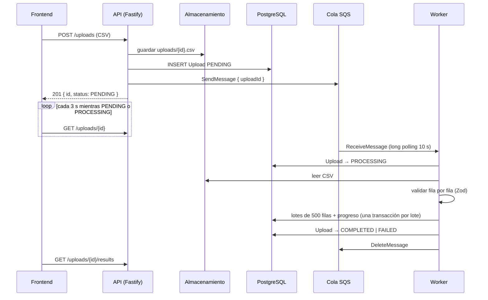
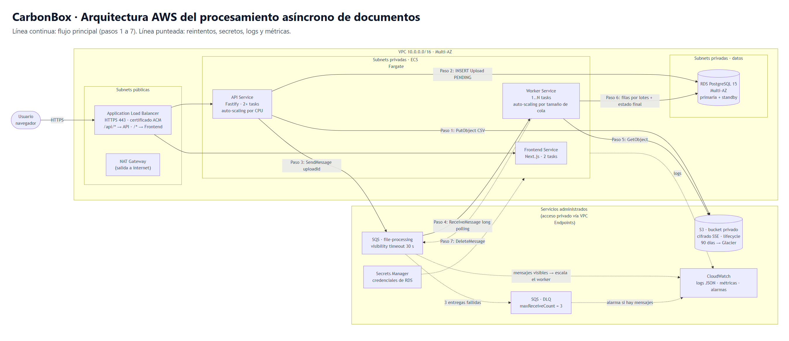

# CarbonBox · Procesamiento asíncrono de documentos

Sistema full stack para **subir archivos CSV con datos de actividad** (energía, gas, transporte, etc.),
procesarlos **de forma asíncrona** con una cola de mensajes y **ver los resultados** cuando terminan.

- **Backend:** Node.js 22 + TypeScript, Fastify, Prisma + PostgreSQL, Awilix, Zod.
  Arquitectura **DDD + Clean Architecture + CQRS + Either**.
- **Mensajería:** API de **AWS SQS** (ElasticMQ en local) con **Dead Letter Queue** y reintentos.
- **Frontend:** Next.js 15 (App Router), TanStack Query (polling), Axios, Tailwind CSS 4.
- **Infra:** Docker Compose con 5 servicios (postgres, sqs, api, worker, frontend).
- **Tests:** 49 unitarios (dominio, parser, handlers, worker y backoff) y 15 de integración
  (API + worker + PostgreSQL + cola reales), con Vitest.

---

## Requisitos previos
- **Docker Desktop**: para todo lo demás basta con esto.
- **Node.js 22+** y **npm 11+**: solo para desarrollo local fuera de Docker.

## Opción A: todo con Docker (recomendada para evaluar)

```powershell
docker compose up -d --build
```

| Servicio | URL |
|---|---|
| Frontend | http://localhost:3000 |
| API | http://localhost:3001/api/v1 · salud en http://localhost:3001/health |
| PostgreSQL | `localhost:5433` (usuario/clave `postgres`) |
| Cola (API SQS) | http://localhost:9324 |

La API aplica las migraciones al arrancar (`prisma migrate deploy`) y el worker espera a que la API esté sana.
Para apagar todo: `docker compose down`, o `docker compose down -v` para borrar también los datos.

## Opción B: desarrollo local (hot reload)

```powershell
# Infraestructura
docker compose up -d postgres sqs

# Backend (terminal 1)
cd backend
copy .env.example .env
npm install
npx prisma migrate dev
npm run dev

# Worker (terminal 2)
cd backend
npm run worker

# Frontend (terminal 3)
cd frontend
copy .env.example .env.local
npm install
npm run dev
```

Calidad (en `backend/` y `frontend/`): `npm run typecheck` y `npm run lint`.

Tests (en `backend/`):
```powershell
npm test                    # 49 tests unitarios, no necesitan Docker
copy .env.test.example .env.test
npm run test:integration    # 15 tests de integración: requieren "docker compose up -d postgres sqs"
```
Los tests de integración usan su propia base de datos (`document_processing_test`, creada y migrada
automáticamente) y sus propias colas, así que no tocan los datos de desarrollo.

> El contenedor de PostgreSQL se expone en el puerto **5433** para no chocar con un PostgreSQL
> instalado en Windows ([ADR-005](docs/decisiones/ADR-005-versiones-y-puertos.md)).

---

## Cómo probarlo
1. Abre http://localhost:3000 y entra a **+ Nuevo upload**.
2. Arrastra [`sample-data.csv`](sample-data.csv) (60 filas válidas) y pulsa **Subir y procesar**.
3. Te lleva al detalle: verás **Pendiente → Procesando → Completado** sin recargar (polling cada 3 s)
   y la tabla con las 60 filas.
4. Repite con [`sample-data-con-errores.csv`](sample-data-con-errores.csv): queda **Completado**
   con 2 filas guardadas y 7 con error, cada una con su número de fila y el motivo.
5. Prueba los casos que fallan por completo: [`sample-data-header-invalido.csv`](sample-data-header-invalido.csv),
   [`sample-data-solo-header.csv`](sample-data-solo-header.csv) y [`sample-data-vacio.csv`](sample-data-vacio.csv) quedan **Fallido**.
6. **Qué observar:** apaga el worker (`docker compose stop worker`), sube un archivo y verás que se
   queda en *Pendiente*. Enciéndelo (`docker compose start worker`) y la página se actualiza sola.

Con `curl`:
```powershell
curl.exe -F "file=@sample-data.csv" http://localhost:3001/api/v1/uploads
curl.exe http://localhost:3001/api/v1/uploads/<id>
curl.exe http://localhost:3001/api/v1/uploads/<id>/results
curl.exe "http://localhost:3001/api/v1/uploads?page=1&limit=10"
curl.exe http://localhost:3001/api/v1/uploads/stats
```

## API

| Método | Ruta | Respuesta |
|---|---|---|
| POST | `/api/v1/uploads` (multipart, campo `file`, `.csv`, máx. 10 MB) | `201 { id, status, fileName, createdAt }` |
| GET | `/api/v1/uploads/:id` | `{ id, status, fileName, totalRows, processedRows, failedRows, errorMessage, createdAt, updatedAt }` |
| GET | `/api/v1/uploads?page=1&limit=10` | `{ data, total, page, limit }` |
| GET | `/api/v1/uploads/:id/results` | `{ data: [{ category, amount, unit, date }] }` |
| GET | `/api/v1/uploads/stats` | `{ total, pending, processing, completed, failed }` (extra, [ADR-004](docs/decisiones/ADR-004-desviaciones-del-enunciado.md)) |
| GET | `/health` | `{ status: "ok" }` |

Errores: `{ error, message }` con **400** (validación), **404** (no existe), **409** (transición inválida),
**413** (archivo muy grande), **503** (cola no disponible) y **500** (inesperado, sin detalles internos).

---

## Arquitectura

### Flujo


Si el worker falla por algo transitorio (DB caída, archivo ilegible) **no borra el mensaje**: lo reprograma
con **exponential backoff** (10 s, luego 40 s...) cambiando su *visibility timeout*. En el 3.er intento el upload se
marca `FAILED` y el mensaje pasa a la **DLQ**. Los errores de negocio no se reintentan
([ADR-003](docs/decisiones/ADR-003-reintentos-progreso-y-dlq.md), [ADR-007](docs/decisiones/ADR-007-backoff-y-tests-de-integracion.md)).

### Bounded context y capas
Un solo bounded context, `document-processing`, con Clean Architecture (las dependencias apuntan hacia adentro):

```
backend/src/
├── main/                      App.ts (Fastify) e index.ts (arranque y apagado limpio)
├── config/                    Convict: valida variables de entorno al arrancar
├── shared/                    Kernel compartido: Either, DomainError, AggregateRoot, ICommandHandler,
│                              IQueryHandler, IMessagePublisher/Consumer, BaseController, error handler
├── workers/                   FileProcessingWorker (proceso separado: npm run worker)
└── document-processing/
    ├── domain/                Upload (aggregate root), ActivityData, UploadStatus, FileName,
    │                          IUploadRepository, IActivityDataRepository. Sin librerías externas.
    ├── application/           commands/ (CreateUpload, ProcessFile, FailUpload) · queries/ (GetUploadById,
    │                          ListUploads, GetUploadResults, GetUploadStats) · CsvParserService · puertos
    ├── infrastructure/        Prisma (repositorios + mappers), SQS, LocalFileStorage, contenedor Awilix
    └── presentation/          Controllers (sin Fastify) y rutas (adaptador Fastify)
```

| Patrón | Dónde se ve |
|---|---|
| **DDD** | `Upload` protege sus transiciones (`PENDING → PROCESSING → COMPLETED/FAILED`); cualquier otra retorna `Left`. Los value objects `FileName` y `UploadStatus` se validan al crearse. |
| **Clean Architecture** | `domain` no importa nada externo; **ESLint lo impide** (`no-restricted-imports`). Los mappers traducen entre Prisma y el dominio. |
| **CQRS** | Commands que escriben y queries que leen, cada uno con su handler, sus objetos y `Either<DomainError, T>` como resultado. |
| **Either** | Ningún error de negocio se lanza con `throw`. Los controllers no tienen `try/catch`: un `Left` llega al **error handler central**, que lo traduce a HTTP. |
| **Inyección de dependencias** | Awilix (`InjectionMode.PROXY`). Los handlers dependen de interfaces; `DocumentProcessingModule.ts` decide las implementaciones. |
| **Puertos y adaptadores** | `IFileStorage` e `IMessagePublisher`: cambiar a S3 o a otra cola no toca dominio ni aplicación. |

Frontend: `src/features/document-processing/` (api, components, types) y `src/shared/` (cliente Axios,
QueryClient, layout).

### AWS
Diagrama de despliegue en [docs/arquitectura-aws.md](docs/arquitectura-aws.md):



---

## Decisiones técnicas
Cada decisión está en [`docs/decisiones/`](docs/decisiones):

| ADR | Decisión |
|---|---|
| [001](docs/decisiones/ADR-001-cola-sqs-localstack.md) | La cola en memoria del enunciado **no funciona entre procesos**. Se usa la API real de SQS. LocalStack ahora exige cuenta, así que en local se usa **ElasticMQ** (mismo SDK) y almacenamiento en disco. |
| [002](docs/decisiones/ADR-002-polling-en-pending-y-processing.md) | Polling también en **PENDING**: si no, un upload recién creado nunca se actualiza. |
| [003](docs/decisiones/ADR-003-reintentos-progreso-y-dlq.md) | Reintentos (`PROCESSING → PROCESSING`), `FAILED` en el último intento, una transacción por lote para que el progreso sea visible y parseo en memoria para conocer el total. |
| [004](docs/decisiones/ADR-004-desviaciones-del-enunciado.md) | `enum` de Prisma para el estado y endpoint `/stats`. |
| [005](docs/decisiones/ADR-005-versiones-y-puertos.md) | Versiones fijadas (Prisma 6, TS 5, Vitest 3...) y PostgreSQL en el puerto 5433. |
| [006](docs/decisiones/ADR-006-frontend-decisiones.md) | Página en la URL, Tailwind v4 sin `tailwind.config.ts`, diseño tipo libro contable y polling pausado en segundo plano. |
| [007](docs/decisiones/ADR-007-backoff-y-tests-de-integracion.md) | Reintentos con exponential backoff (`ChangeMessageVisibility`) y tests de integración con base de datos y colas propias. |

**¿Por qué estas librerías?**
- **Fastify:** lo pide el enunciado; trae logging estructurado con pino y un buen sistema de plugins.
- **Zod:** valida cada fila y convierte los tipos en un solo paso, con mensajes por campo.
- **csv-parse:** maneja comillas, BOM y CSV mal formados mejor que un `split(',')`.
- **Awilix:** lo recomienda el enunciado; el modo PROXY encaja con constructores que reciben `{ dependencias }`.
- **Vitest:** funciona con TypeScript sin configuración extra.

### Política de procesamiento
- Header obligatorio `category,amount,unit,date` (sin importar mayúsculas, espacios o BOM).
- `amount` > 0; `date` en formato `YYYY-MM-DD` y además una fecha real (`2024-02-30` se rechaza); `category` y `unit` no vacíos.
- Archivo vacío, header inválido o sin filas → **FAILED**.
- Las filas válidas se guardan y las inválidas cuentan en `failedRows`. Al menos una válida → **COMPLETED**
  con un resumen de hasta 20 errores en `errorMessage`. Ninguna válida → **FAILED**.
- Idempotencia: un mensaje duplicado para un upload terminado se ignora.

## Limitaciones conocidas
- **Almacenamiento local** en vez de S3. La interfaz existe (`IFileStorage`), pero no se implementó
  `S3FileStorage` porque no hay un S3 local gratuito sin cuenta que valga la pena para esta prueba.
  En Docker, la API y el worker comparten un volumen.
- **Sin autenticación**: usuario fijo `user-123`, como permite el enunciado.
- **Parseo en memoria** con límite de 10 MB; para archivos de cientos de MB habría que usar streaming
  y contar filas en dos pasadas.
- **Tests:** backend con tests unitarios y de integración; el frontend no tiene tests automatizados
  (se verificó manualmente en el navegador, incluido el ancho de móvil).
- Las migraciones se aplican al arrancar la API; en producción irían en una tarea separada del pipeline.
- `package.json#prisma` está deprecado en Prisma 7; se mantiene porque el proyecto fija Prisma 6.

## Documentación del proceso
- [USO-DE-IA.md](USO-DE-IA.md): cómo se usó la IA, qué se corrigió y qué se aprendió.
- [docs/fases/](docs/fases): qué se construyó en cada fase, cómo probarlo y preguntas de repaso.
- [docs/bitacora-ia.md](docs/bitacora-ia.md): bitácora fase por fase.
