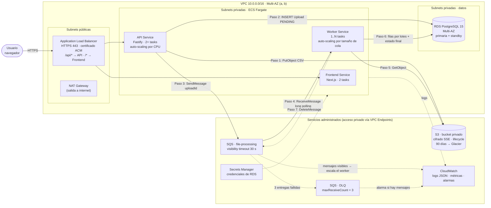

# Arquitectura en AWS (propuesta de despliegue)

Imagen exportada: [`arquitectura-aws.png`](arquitectura-aws.png). Fuente Mermaid:

## Cómo se conectan los componentes

| Componente | Rol | Seguridad / disponibilidad |
|---|---|---|
| **ALB** (subnets públicas) | Único punto de entrada; termina HTTPS y enruta `/api/*` a la API y el resto al frontend | Security group: 443 desde internet |
| **ECS Fargate – API** | Recibe el CSV, lo sube a S3, crea el `Upload` y publica en SQS | 2+ tasks en 2 AZ; SG: solo acepta tráfico del ALB |
| **ECS Fargate – Worker** | Consume SQS, procesa y guarda en RDS | Escala con *target tracking* sobre `ApproximateNumberOfMessagesVisible`; sin puertos de entrada |
| **ECS Fargate – Frontend** | Sirve Next.js | 2 tasks; SG: solo desde el ALB |
| **RDS PostgreSQL** | Uploads y ActivityData | Multi-AZ con failover automático; SG: 5432 solo desde los SG de API y worker; backups automáticos |
| **S3** | Archivos CSV originales | Bloqueo de acceso público, cifrado SSE-S3, *lifecycle* (90 días → Glacier, 365 → borrar) |
| **SQS + DLQ** | Desacopla API y worker; reintentos nativos | Redrive a la DLQ tras 3 intentos; alarma en CloudWatch si la DLQ tiene mensajes |
| **Secrets Manager** | `DATABASE_URL` / credenciales de RDS | Se inyecta como *secret* en la task definition; rotación automática |
| **CloudWatch** | Logs (pino en JSON), métricas y alarmas | Log groups por servicio; alarmas de DLQ, 5xx del ALB y CPU de RDS |
| **ECR** | Registro de las imágenes Docker de los 3 servicios | Escaneo de vulnerabilidades al subir |
| **VPC Endpoints / NAT** | Acceso privado a servicios AWS; NAT solo para salida a internet | El tráfico a S3/SQS no sale a internet |
| **IAM (task roles)** | Mínimo privilegio | API: `s3:PutObject`, `sqs:SendMessage`. Worker: `s3:GetObject`, `sqs:ReceiveMessage/DeleteMessage` |

## Qué cambia en el código para desplegar aquí
- `IFileStorage`: una clase `S3FileStorage` (`PutObject` / `GetObject`) en lugar de `LocalFileStorage`.
  Se registra en Awilix; dominio y aplicación no cambian.
- `SQS_ENDPOINT` vacío (usa AWS real) y `SQS_QUEUE_URL` con la URL de la cola real.
- Credenciales: el SDK toma el *task role* de ECS automáticamente (sin access keys).
- `prisma migrate deploy` como *task* de ECS separada antes del despliegue, en vez de al arrancar la API.
